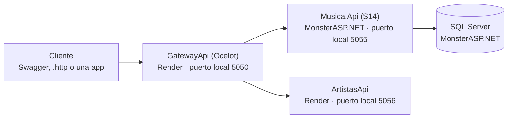

# Musica · Microservicios con API Gateway y Ocelot

Solución de microservicios con un **API Gateway (Ocelot)** como único punto de entrada. El cliente solo conoce la dirección del gateway, que reenvía las peticiones a dos microservicios: la **API de música en capas con JWT** (Semana 14) y un segundo servicio de **artistas**. Los tres servicios están publicados en la nube con planes gratuitos.

## Datos del curso

| | |
|---|---|
| **Curso** | Desarrollo de Aplicaciones Empresariales Avanzadas |
| **Sección** | 6 - C24 - Sección C  |
| **Docente** | Edwin William Arévalo Sermeño |
| **Laboratorio** | Microservicios con API Gateway y Ocelot (Semana 15) |
| **Institución** | TECSUP |

## Enlaces

| Servicio | URL pública |
|---|---|
| **Repositorio** | https://github.com/lynmad05/MusicaCapas (rama `master`) |
| **Gateway (GatewayApi)** | https://musica-gateway.onrender.com |
| **Microservicio 1 (Musica.Api)** | http://musica-capas.runasp.net · [Swagger](http://musica-capas.runasp.net/swagger/index.html) |
| **Microservicio 2 (ArtistasApi)** | https://musica-artistas.onrender.com |
| **Video de sustentación** | Se agrega al subir el video |

## Qué hace cada servicio

- **Musica.Api (microservicio 1):** la API de la Semana 14, sin cambiar su lógica. Administra álbumes y canciones, con autenticación JWT y roles (Oyente, Curador y GerenteCatalogo). Usa su propia base de datos SQL Server (`MusicaDB`) y está organizada en capas (Entidades, Datos, Negocio y API) con DTOs y AutoMapper.
- **ArtistasApi (microservicio 2):** servicio pequeño con datos en memoria (sin base de datos). Expone la lista de artistas y el detalle por id. Valida el mismo JWT y exige token en todos sus endpoints.
- **GatewayApi:** API Gateway con Ocelot. Recibe todas las peticiones del cliente, valida el token cuando la ruta lo exige y reenvía al servicio correspondiente.

## Arquitectura

Cada servicio corre en su propio proceso y puerto. No comparten base de datos ni clases. Aunque la solución tiene seis carpetas, solo tres se ejecutan: `Musica.Entidades`, `Musica.Datos` y `Musica.Negocio` son librerías que forman las capas de `Musica.Api`.

| Proyecto | Puerto local | Contenido |
|---|---|---|
| `GatewayApi` | 5050 | Ocelot, `ocelot.json`, `ocelot.Production.json`, validación de JWT |
| `Musica.Api` | 5055 | API en capas de la S14 (con `Musica.Negocio`, `Musica.Datos` y `Musica.Entidades`) |
| `ArtistasApi` | 5056 | Minimal API con datos en memoria y validación de JWT |

## Tabla de rutas (upstream y downstream)

| Upstream (cliente → gateway) | Método | Downstream local (gateway → servicio) | Downstream en la nube | Token |
|---|---|---|---|---|
| `/gateway/auth/{everything}` | POST | `localhost:5055` `/api/auth/{everything}` | `musica-capas.runasp.net:80` (http) `/api/auth/{everything}` | No |
| `/gateway/auth/perfil` | GET | `localhost:5055` `/api/auth/perfil` | `musica-capas.runasp.net:80` (http) `/api/auth/perfil` | Sí |
| `/gateway/albumes{everything}` | GET | `localhost:5055` `/api/albumes{everything}` | `musica-capas.runasp.net:80` (http) `/api/albumes{everything}` | No |
| `/gateway/canciones{everything}` | GET | `localhost:5055` `/api/canciones{everything}` | `musica-capas.runasp.net:80` (http) `/api/canciones{everything}` | No |
| `/gateway/albumes{everything}` | POST, PUT, DELETE | `localhost:5055` `/api/albumes{everything}` | `musica-capas.runasp.net:80` (http) `/api/albumes{everything}` | Sí |
| `/gateway/canciones{everything}` | POST, PUT, DELETE | `localhost:5055` `/api/canciones{everything}` | `musica-capas.runasp.net:80` (http) `/api/canciones{everything}` | Sí |
| `/gateway/artistas{everything}` | GET | `localhost:5056` `/api/artistas{everything}` | `musica-artistas.onrender.com:443` (https) `/api/artistas{everything}` | Sí |

`GlobalConfiguration.BaseUrl` en la nube: `https://musica-gateway.onrender.com`.

**Nota sobre el HTTP hacia Musica.Api:** en MonsterASP la conexión del gateway por `https` dio error de SSL, por eso las seis rutas hacia `Musica.Api` usan `http` y el puerto 80. Es una limitación de este despliegue gratuito: ese tramo entre el gateway y `Musica.Api` viaja sin cifrar. El cliente sí usa `https` hacia el gateway y hacia `ArtistasApi`.

## Cómo se valida el JWT

- **En el gateway:** las rutas marcadas con `AuthenticationOptions` (esquema `Bearer`) rechazan con **401** cualquier petición sin token válido, antes de reenviarla.
- **En los servicios:** `Musica.Api` y `ArtistasApi` validan otra vez el token (emisor, audiencia, vencimiento y firma) con la **misma clave, emisor y audiencia**. Los roles los sigue exigiendo `Musica.Api`.

La clave del JWT es **la misma en los tres servicios** y nunca se sube al repositorio.

## Roles (Musica.Api)

| Rol | Qué puede hacer |
|---|---|
| **Oyente** | Consultar el catálogo y ver su perfil |
| **Curador** | Lo del Oyente, y crear y editar álbumes y canciones |
| **GerenteCatalogo** | Lo del Curador, y eliminar álbumes y canciones |

## Despliegue en la nube

| Servicio | Proveedor (plan gratuito) | Cómo se publicó |
|---|---|---|
| **Musica.Api + base de datos SQL Server** | MonsterASP.NET | `dotnet publish` y subida del contenido al website; script SQL ejecutado en la base de la nube |
| **ArtistasApi** | Render (Docker) | Servicio web con *Root Directory* `ArtistasApi` y su `Dockerfile` |
| **GatewayApi** | Render (Docker) | Servicio web con *Root Directory* `GatewayApi`, su `Dockerfile` y `ocelot.Production.json` |

**Por qué estos proveedores:** MonsterASP.NET ofrece hosting para .NET con SQL Server incluido y sin tarjeta, así que no hubo que cambiar el proveedor de EF Core. Su plan gratuito permite un solo website por cuenta, por eso `ArtistasApi` y `GatewayApi` se publicaron en Render, que permite desplegar contenedores Docker gratis. En los planes gratuitos el primer request puede tardar porque el servicio se duerme tras un rato sin tráfico.

## Pruebas

El archivo `pruebas.http` ejecuta todas las pruebas **por el gateway** y cubre los códigos 200, 201, 204, 401, 403, 404 y 502. También se llama directamente al microservicio 2 sin token para comprobar que responde 401. Se hicieron primero en el equipo local y luego sobre el gateway publicado (`pruebas-nube.http`).

| Código | Prueba |
|---|---|
| 200 | `GET /gateway/albumes` sin token (ruta pública) y `GET /gateway/artistas` con token |
| 201 | `POST /gateway/albumes` con el rol Curador |
| 204 | `PUT` y `DELETE` con los roles Curador y GerenteCatalogo |
| 401 | `GET /gateway/artistas` sin token (rechaza el gateway) y `GET /api/artistas` directo a ArtistasApi sin token (rechaza el propio servicio) |
| 403 | `POST /gateway/albumes` con el rol Oyente |
| 404 | `GET /gateway/albumes/9999` y la ruta inexistente `/gateway/cosa` |
| 502 | `GET /gateway/artistas` con el microservicio 2 caído (en local, con `ArtistasApi` detenido) |

## Autora

**Ailyn** · Estudiante de Desarrollo de Software · TECSUP
