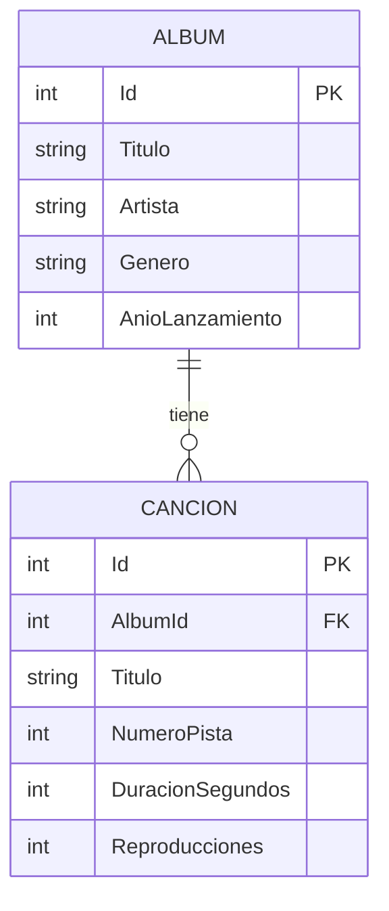
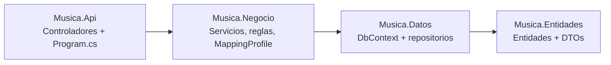

# Musica API en capas · DTOs y AutoMapper

Web API REST en **capas** (Entidades, Datos, Negocio y API) desarrollada con **ASP.NET Core (.NET 10)** y **Entity Framework Core**. La API expone **solo DTOs** y los convierte con **AutoMapper**. Las entidades nunca salen de la API.

## Datos del curso

| | |
|---|---|
| **Curso** | Desarrollo de Aplicaciones Empresariales Avanzadas |
| **Sección** | 6 - C24 - Sección C  |
| **Docente** | Edwin William Arévalo Sermeño |
| **Laboratorio** | API en capas con DTOs y AutoMapper (Semana 13) |
| **Institución** | TECSUP |

## Qué problema resuelve

Permite administrar un catálogo de álbumes y sus canciones desde cualquier aplicación (web o móvil), sin que esta se conecte directo a la base de datos. La API ordena el trabajo en capas para que cada parte tenga una sola responsabilidad: la base de datos, las reglas del negocio y la exposición de los endpoints.

## Entidades y relación

- **Album:** título, artista, género y año de lanzamiento.
- **Cancion:** título, número de pista, duración en segundos, reproducciones y el álbum al que pertenece.

Relación **1:N**: un álbum tiene muchas canciones y cada canción pertenece a un solo álbum (`Cancion.AlbumId` es la clave foránea).



## Reglas de negocio

Viven en la capa de Negocio (servicios) y lanzan `ReglaNegocioException`. El controlador la convierte en **409 Conflict**.

1. No se puede repetir un álbum con el mismo título y artista.
2. No se puede repetir el número de pista dentro del mismo álbum.
3. No se puede eliminar un álbum que ya tiene canciones.

Si el `albumId` de una canción no existe, el servicio lanza `DatoInvalidoException` y el controlador responde **400** con `ValidationProblem`.

## Arquitectura en capas



| Proyecto | Contenido |
|---|---|
| **Musica.Entidades** | `Album`, `Cancion` (generadas con Scaffold, sin `[JsonIgnore]`) y los DTOs |
| **Musica.Datos** | `MusicaContext` y repositorios con su interfaz (`IAlbumRepositorio`, `ICancionRepositorio`) |
| **Musica.Negocio** | Servicios con su interfaz, reglas de negocio, excepciones y `MappingProfile` |
| **Musica.Api** | Controladores, Swagger, inyección de dependencias en `Program.cs` |

El controlador solo usa **servicios (por su interfaz) y DTOs**: nunca el `DbContext` ni las entidades.

## DTOs

| DTO | Uso |
|---|---|
| `AlbumDto` | Lectura. Incluye `TotalCanciones` |
| `CancionDto` | Lectura. Incluye `AlbumTitulo` en lugar del objeto álbum |
| `AlbumCrearDto` / `AlbumActualizarDto` | Entrada (POST y PUT) con Data Annotations |
| `CancionCrearDto` / `CancionActualizarDto` | Entrada (POST y PUT) con Data Annotations |

## Sustentación de los mapeos (MappingProfile)

| Mapeo | Origen → Destino | ¿Por qué en ese sentido? | Configuración especial |
|---|---|---|---|
| `Album` → `AlbumDto` | Entidad → DTO de lectura | Es lo que la API devuelve al cliente: la entidad no debe salir de la API | `ForMember`: `TotalCanciones` toma `Cancions.Count` |
| `Cancion` → `CancionDto` | Entidad → DTO de lectura | Es lo que la API devuelve al cliente: la entidad no debe salir de la API | `ForMember`: `AlbumTitulo` toma el `Titulo` del álbum |
| `AlbumCrearDto` → `Album` | DTO de entrada → Entidad | Es lo que llega del cliente y se convierte en entidad para guardarla; no se devuelve | Ninguna: los nombres coinciden (`Id` y `Cancions` los genera la base de datos) |
| `AlbumActualizarDto` → `Album` | DTO de entrada → Entidad | Se usa con `Map(origen, destino)` para copiar los datos nuevos sobre la entidad que ya existe | Ninguna: los nombres coinciden |
| `CancionCrearDto` → `Cancion` | DTO de entrada → Entidad | Es lo que llega del cliente y se convierte en entidad para guardarla; no se devuelve | Ninguna: los nombres coinciden |
| `CancionActualizarDto` → `Cancion` | DTO de entrada → Entidad | Se usa con `Map(origen, destino)` para copiar los datos nuevos sobre la entidad que ya existe | Ninguna: los nombres coinciden |

**No se usó `ReverseMap()`** porque cada dirección tiene un DTO distinto: el de lectura solo sale de la API y los de entrada solo entran. Un `ReverseMap` mezclaría los dos sentidos en un mismo DTO.

## Endpoints

### Álbumes · `/api/albumes`

| Método | Ruta | Descripción |
|---|---|---|
| GET | `/api/albumes` | Lista álbumes. Filtros: `artista`, `genero`, `anio`, `q` |
| GET | `/api/albumes/{id}` | Obtiene un álbum |
| GET | `/api/albumes/{id}/canciones` | Canciones de un álbum (ruta anidada) |
| POST | `/api/albumes` | Crea un álbum |
| PUT | `/api/albumes/{id}` | Actualiza un álbum |
| DELETE | `/api/albumes/{id}` | Elimina un álbum |

### Canciones · `/api/canciones`

| Método | Ruta | Descripción |
|---|---|---|
| GET | `/api/canciones` | Lista canciones. Filtros: `albumId`, `titulo`, `duracionMax` |
| GET | `/api/canciones/{id}` | Obtiene una canción |
| POST | `/api/canciones` | Crea una canción |
| PUT | `/api/canciones/{id}` | Actualiza una canción |
| DELETE | `/api/canciones/{id}` | Elimina una canción |

## Códigos de respuesta

| Código | Resultado | Cuándo |
|---|---|---|
| 200 | `Ok(datos)` | GET que devuelve DTOs |
| 201 | `CreatedAtAction(...)` | POST correcto |
| 204 | `NoContent()` | PUT y DELETE correctos |
| 400 | `ValidationProblem(...)` | Datos inválidos del DTO de entrada o `albumId` inexistente |
| 404 | `NotFound()` | El recurso no existe |
| 409 | `Conflict(...)` | Se rompe una regla de negocio |

## Estructura de la solución

```
MusicaCapas/
├── Musica.slnx
├── Scripts/
│   ├── 01_CrearBaseLocal.sql
│   └── 02_MusicaDB.sql
├── pruebas.http
├── Musica.Entidades/
│   ├── Album.cs
│   ├── Cancion.cs
│   └── Dtos/
├── Musica.Datos/
│   ├── MusicaContext.cs
│   └── Repositorios/
├── Musica.Negocio/
│   ├── Excepciones/
│   ├── Mapeos/MappingProfile.cs
│   └── Servicios/
└── Musica.Api/
    ├── Controllers/
    └── Program.cs
```

## Generación del modelo (Scaffold)

```bash
dotnet ef dbcontext scaffold "Name=ConnectionStrings:MusicaDB" Microsoft.EntityFrameworkCore.SqlServer --project Musica.Datos --startup-project Musica.Api --output-dir Models --context MusicaContext --namespace Musica.Entidades --context-namespace Musica.Datos --no-onconfiguring --force
```

Después se mueven `Album.cs` y `Cancion.cs` al proyecto `Musica.Entidades` y `MusicaContext.cs` queda en `Musica.Datos`.

## Pruebas

El archivo `pruebas.http` contiene las pruebas de todos los endpoints y de los códigos 200, 201, 204, 400, 404 y 409. Se ejecutan con la extensión **REST Client** de VS Code, cambiando el puerto de `@host` por el que muestra `dotnet run`.

## Autora

**Ailyn** · Estudiante de Desarrollo de Software · TECSUP
