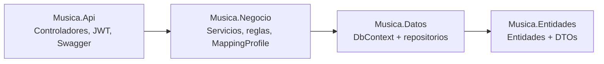

# Musica API en capas · DTOs, AutoMapper y autenticación JWT

Web API REST en **capas** (Entidades, Datos, Negocio y API) con **ASP.NET Core (.NET 10)** y **Entity Framework Core**. Expone solo DTOs (AutoMapper) y está protegida con **autenticación JWT** y **roles propios del negocio**.

## Datos del curso

| | |
|---|---|
| **Curso** | Desarrollo de Aplicaciones Empresariales Avanzadas |
| **Sección** | 6 - C24 - Sección C  |
| **Docente** | Edwin William Arévalo Sermeño |
| **Laboratorio** | API en capas con autenticación JWT (Semana 14) |
| **Institución** | TECSUP |

## Qué problema resuelve

Administra un catálogo de álbumes y sus canciones. Cualquiera puede consultar el listado, pero las demás acciones exigen iniciar sesión y, según el rol, se puede crear, editar o eliminar contenido. Así el catálogo queda protegido y cada persona solo hace lo que le corresponde.

## Entidades y relación

- **Album:** título, artista, género y año de lanzamiento.
- **Cancion:** título, número de pista, duración, reproducciones y álbum.
- **Usuario:** correo (único), hash de la clave y rol.

Relación **1:N** entre Album y Cancion. La entidad Usuario es independiente.

## Reglas de negocio (409 Conflict)

1. No se puede repetir un álbum con el mismo título y artista.
2. No se puede repetir el número de pista dentro del mismo álbum.
3. No se puede eliminar un álbum que ya tiene canciones.
4. No se puede registrar un usuario con un correo que ya existe.

## Roles

| Rol | Qué puede hacer |
|---|---|
| **Oyente** | Es el rol que recibe todo usuario nuevo. Consulta el catálogo completo y ve su perfil |
| **Curador** | Todo lo del Oyente, y además crea y edita álbumes y canciones |
| **GerenteCatalogo** | Todo lo del Curador, y además elimina álbumes y canciones |

El rol lo asigna **el servidor** (el registro siempre crea un Oyente). Para subir de rol se cambia en la base de datos.

## Matriz de permisos

| Endpoint | Sin token | Oyente | Curador | GerenteCatalogo |
|---|---|---|---|---|
| POST /api/auth/registro | Sí | Sí | Sí | Sí |
| POST /api/auth/login | Sí | Sí | Sí | Sí |
| GET /api/auth/perfil | No (401) | Sí | Sí | Sí |
| GET /api/albumes | Sí | Sí | Sí | Sí |
| GET /api/albumes/{id} | No (401) | Sí | Sí | Sí |
| GET /api/albumes/{id}/canciones | No (401) | Sí | Sí | Sí |
| POST /api/albumes | No (401) | No (403) | Sí | Sí |
| PUT /api/albumes/{id} | No (401) | No (403) | Sí | Sí |
| DELETE /api/albumes/{id} | No (401) | No (403) | No (403) | Sí |
| GET /api/canciones | Sí | Sí | Sí | Sí |
| GET /api/canciones/{id} | No (401) | Sí | Sí | Sí |
| POST /api/canciones | No (401) | No (403) | Sí | Sí |
| PUT /api/canciones/{id} | No (401) | No (403) | Sí | Sí |
| DELETE /api/canciones/{id} | No (401) | No (403) | No (403) | Sí |

## Arquitectura en capas

Lo nuevo de esta semana:

| Capa | Se agregó |
|---|---|
| **Entidades** | `Usuario`, `LoginDto`, `RegistroDto`, `TokenDto`, `PerfilDto` |
| **Datos** | `IUsuarioRepositorio` y `UsuarioRepositorio` |
| **Negocio** | `IAuthServicio` y `AuthServicio` (BCrypt y generación del token), `JwtOpciones`, `RolesApp` |
| **API** | `AuthController`, autenticación JWT y Swagger con botón Authorize |

## Cómo funciona el JWT

1. El cliente envía su correo y clave a `POST /api/auth/login`.
2. El servicio busca el usuario y compara la clave con el hash usando BCrypt.
3. Si es correcta, genera un token firmado con los claims `sub`, `email`, `role` y `jti`, y una fecha de vencimiento.
4. El cliente envía el token en cada petición: `Authorization: Bearer <token>`.
5. La API valida emisor, audiencia, vencimiento y firma, y aplica `[Authorize]`, `[AllowAnonymous]` o `[Authorize(Roles = "...")]`.

Si las credenciales no son válidas, el login responde **401** igual para correo inexistente o clave incorrecta, para no revelar qué correos existen.

## Endpoints de autenticación

| Método | Ruta | Descripción | Respuestas |
|---|---|---|---|
| POST | `/api/auth/registro` | Crea un usuario con rol Oyente | 201, 400, 409 |
| POST | `/api/auth/login` | Devuelve el token | 200, 400, 401 |
| GET | `/api/auth/perfil` | Correo y rol tomados de los claims del token | 200, 401 |

## Códigos de respuesta

| Código | Cuándo |
|---|---|
| 200 | GET y login correctos |
| 201 | POST correcto (incluye el registro) |
| 204 | PUT y DELETE correctos |
| 400 | Datos inválidos del DTO de entrada |
| 401 | Login con credenciales inválidas, o solicitud sin token a un endpoint protegido |
| 403 | Token válido, pero sin el rol que exige el endpoint |
| 404 | El recurso no existe |
| 409 | Se rompe una regla de negocio |

## Pruebas

El archivo `pruebas.http` contiene las pruebas con un token de cada rol y cubre los códigos 200, 201, 204, 400, 401, 403, 404 y 409. Se ejecutan con la extensión **REST Client** de VS Code.

## Autora

**Ailyn** · Estudiante de Desarrollo de Software · TECSUP
